# Phone AI 实机截图

以下是 2026 年 10 月的手机界面节选。点击图片可查看大图。截图展示当时的交互，其中文字不是当前的日程、天气或使用建议。

### 桌面日历和待办

<a href="calendar-widgets.webp">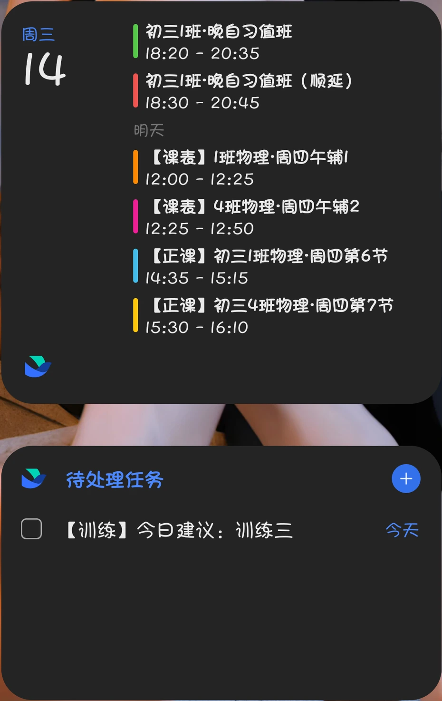</a>

### 从历史通知回忆日程

<a href="schedule-recall.webp">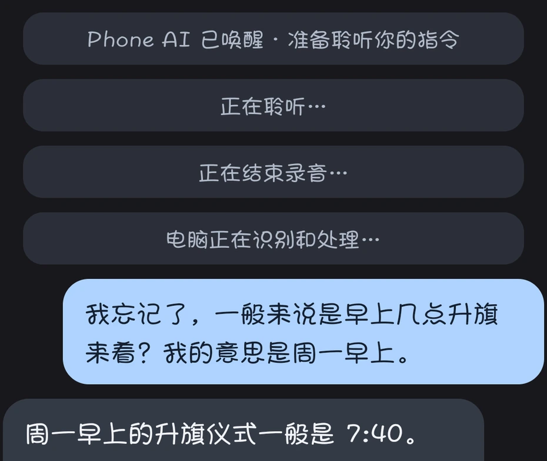</a>

### 语音纠正日期并设置闹钟

<a href="set-alarm.webp">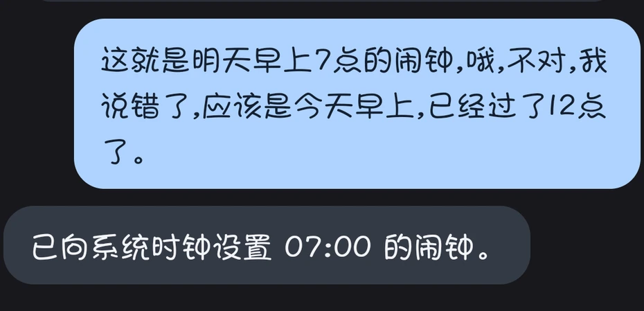</a>

### 回忆朋友通常几点约球

### 结合比赛安排查看降雨趋势

<a href="match-forecast.webp">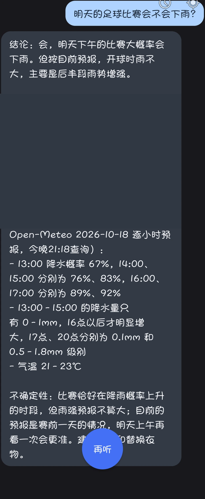</a>

### 查询当前降水

<a href="rain-now.webp">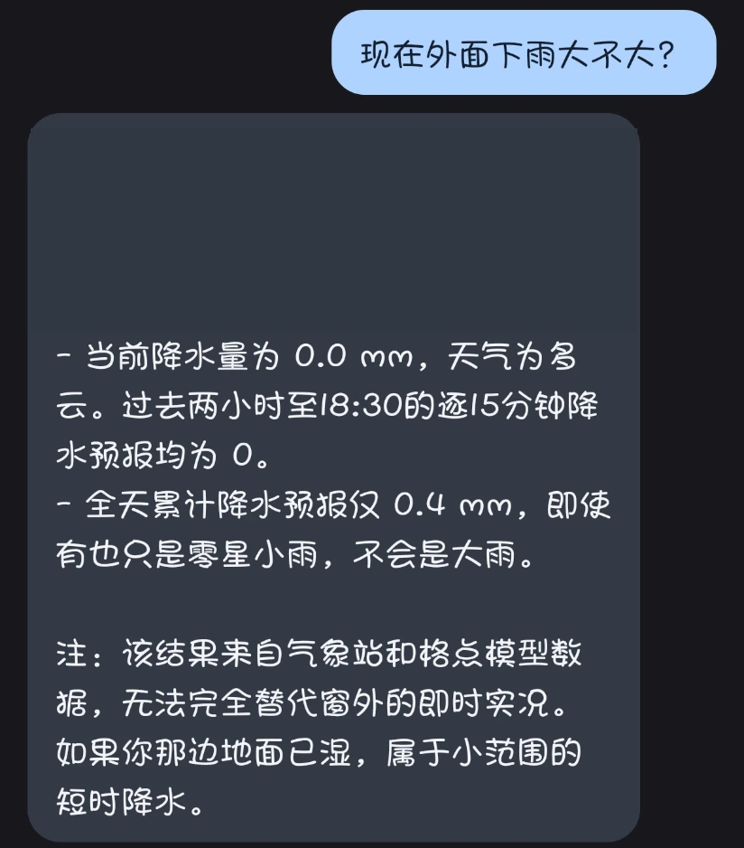</a>

### 按出门时间判断是否带伞

<a href="departure-forecast.webp">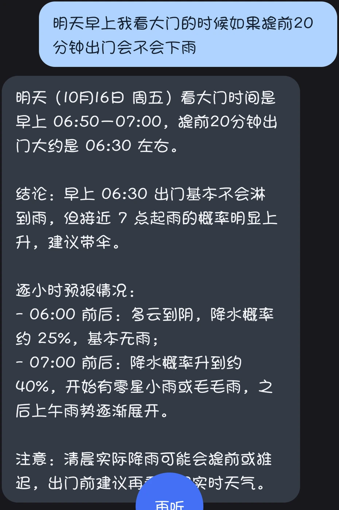</a>

### 结合气温解释体感

<a href="temperature.webp">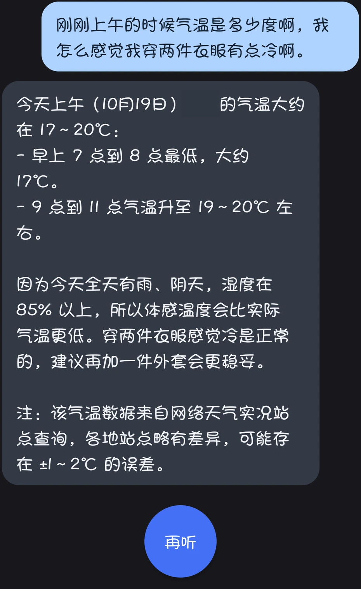</a>

### 日期换算

<a href="weekday.webp">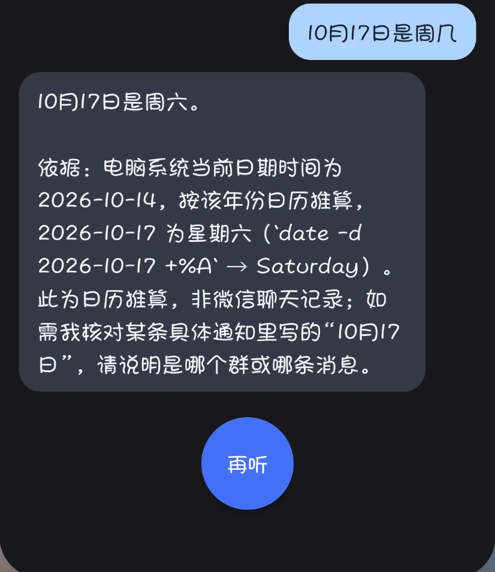</a>

### 带公开来源的问答

<a href="public-source.webp">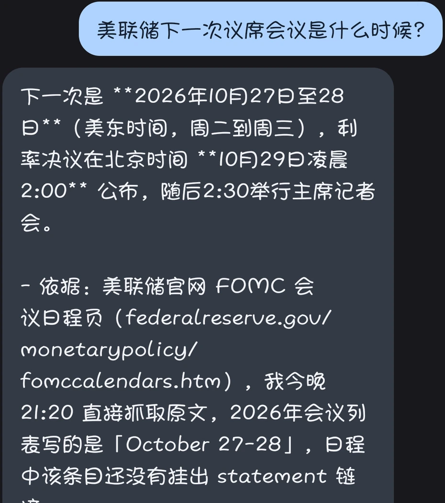</a>

### 厨房日常问答

<a href="cooking.webp">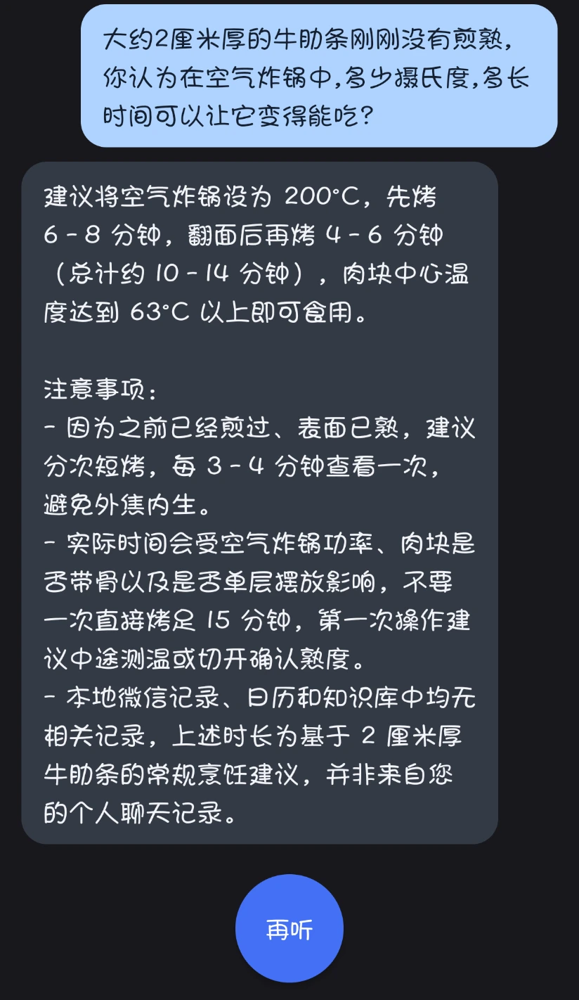</a>

### 结合叙述时间排查家电问题

<a href="appliance-question.webp">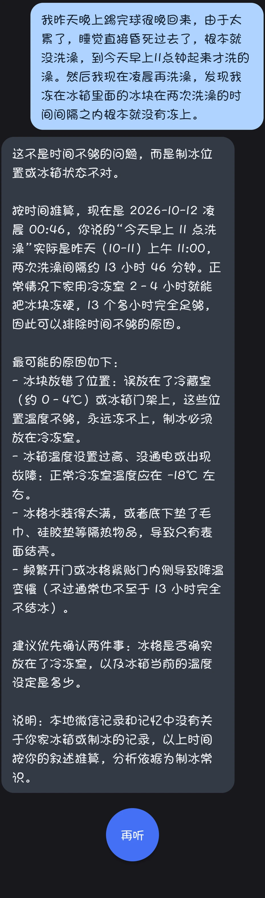</a>
